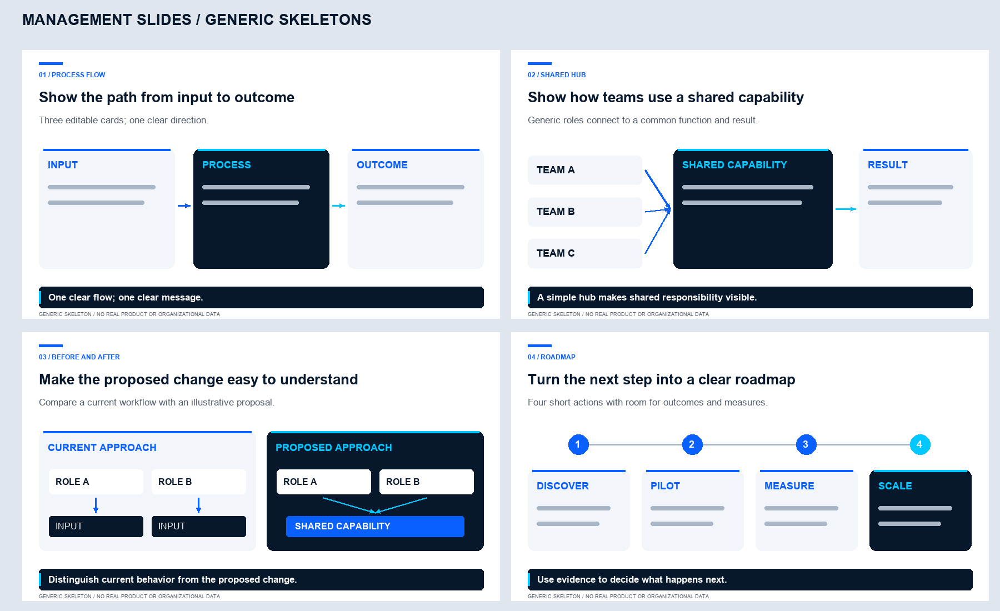

# AI Workbench

**Reusable skills, tools and plugins for practical AI-assisted work.**

A growing, open-source collection of small, documented building blocks. Each item explains what it does, how to install it, what permissions it needs and how to check its output. Start with one capability; install only what you need.

## Available now

| Item | Type | What it does |
| --- | --- | --- |
| [Management Slides](skills/management-slides/) | Agent Skill; Claude Code marketplace package | Creates concise executive presentations with editable PowerPoint diagrams and consistent typography. |

Tools and standalone plugins have their own directories for future additions. They are not populated with pretend implementations.

### Management Slides preview



This image is newly drawn from generic placeholders. It is a visual reference, not a flattened slide to paste into a presentation. The optional generator creates native editable PowerPoint components.

## Get started

### Use a portable skill

Download this repository, inspect the chosen skill and copy its **complete folder** into your tool's documented skill location. For OpenCode:

```text
~/.agents/skills/management-slides/SKILL.md
```

Then ask:

```text
@management-slides Create a four-slide management summary from these documents.
Include an editable process flow. Save the PowerPoint and PDF to [output directory].
```

See [installation instructions and a shareable agent prompt](docs/INSTALL.md). A repository URL by itself does not install a skill in every agent tool.

### Use the Claude Code marketplace

```text
/plugin marketplace add ak-debug/ai-workbench
/plugin install management-slides@ai-workbench
```

Invoke the installed skill as `/management-slides:management-slides`. Marketplace metadata is specific to Claude Code and follows its documented format; end-to-end installation has not yet been verified in a live Claude Code session. The skill itself is portable. This package has no startup hooks or bundled remote services.

## Repository layout

```text
.claude-plugin/marketplace.json   Claude Code installation catalog
skills/                         Self-contained Agent Skills
tools/                          Standalone utilities and integrations
plugins/                        Host-specific plugins
docs/                           Installation and design decisions
scripts/                        Repository validation
tests/                          Repository regression tests
```

Keep each capability independent. A portable skill belongs in `skills/<id>/`; a host-specific integration belongs in `plugins/<id>/`. See [architecture](docs/ARCHITECTURE.md) and [contributing](CONTRIBUTING.md).

See the [validation record](docs/VALIDATION.md) for completed checks and remaining runtime verification, and the [release process](docs/RELEASING.md) for how changes are published.

## Development checks

Use Python 3.10 or later. Create a virtual environment in a suitable scratch location, then install the optional deck dependency:

```sh
python -m pip install -r skills/management-slides/requirements.txt
python scripts/validate_repo.py
python -m unittest discover -s tests -v
python skills/management-slides/scripts/test_layouts.py
```

To regenerate the skeleton PNG, install [preview dependencies](skills/management-slides/requirements-preview.txt) and follow the [skill README](skills/management-slides/README.md). Python packages are not installed automatically when a skill is installed.

## Safety and limitations

- Published examples use generic placeholders, not private presentations or screenshots.
- No credentials, company configuration, telemetry or automatic publishing are bundled.
- Inspect scripts before running them. Agent tools may need filesystem access and approval to execute code.
- The deck generator lays out supplied content; it does not research facts or export PDF.
- Structural tests do not establish visual quality or prove that an AI agent will follow every instruction. Render and inspect real output.
- Privacy checks catch selected patterns, not every possible secret or confidential fact. Human review is required before publication.

## License

[MIT](LICENSE). Third-party dependencies retain their own licenses; Arial is not bundled. See [third-party notices](THIRD_PARTY_NOTICES.md).
