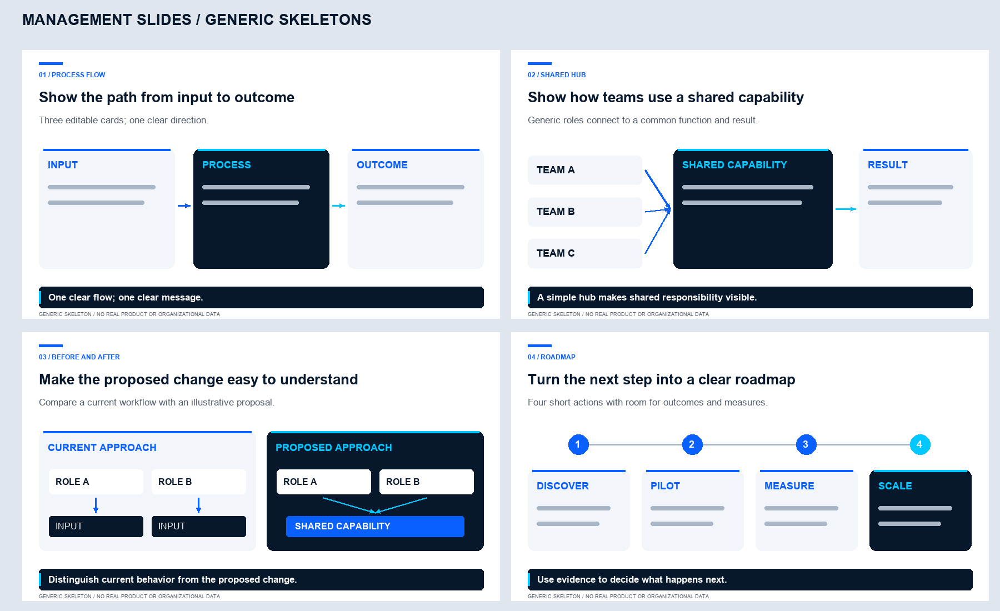

# Management Slides

A portable Agent Skill for clear executive presentations: **3–4 slides**, one message per slide, Arial, white/navy/blue/cyan panels and editable diagrams.



## What's included

| Resource | Purpose |
| --- | --- |
| `SKILL.md` | Agent instructions, visual defaults, evidence rules and revision workflow |
| `references/design-guide.md` | Fonts, colors, geometry, diagram patterns and quality checklist |
| `references/example-deck.json` | Four generic layout skeletons; replace placeholders with vetted content |
| `assets/style-preview.png` | Newly drawn visual reference with no source screenshots or real product data |
| `scripts/build_deck.py` | Optional editable PowerPoint generator; cards move as ungroupable native groups |
| `scripts/build_preview.py` | Recreates the generic skeleton PNG from code |
| `scripts/test_layouts.py` | Structural checks for layouts, live text, fonts, notes, arrowheads and overwrite refusal |
| `requirements.txt` | Optional deck-generation dependency |
| `requirements-preview.txt` | Optional PNG-generation dependency |

## Install and use

Copy this complete folder to your host's supported skill directory. For OpenCode, use `~/.agents/skills/management-slides/`; for standalone Claude Code, use `~/.claude/skills/management-slides/`. See [repository installation instructions](../../docs/INSTALL.md) for marketplace use and other hosts. Installation does not execute the scripts.

Example request:

> Use management-slides to create a four-slide executive summary from these documents. Explain the current situation, proposed change, evidence and next steps. Include an editable flow. Save the PowerPoint and PDF to [directory].

## Generate a deck locally

Use Python 3.10 or later in a virtual environment at a suitable scratch location. Run the following from this skill's directory with that environment's Python:

```sh
python -m pip install -r requirements.txt
python scripts/build_deck.py --help
python scripts/build_deck.py --spec references/example-deck.json --output /path/to/output/Skeleton.pptx
python scripts/test_layouts.py
```

Replace the skeleton's labels with researched, concise content before producing a real presentation. Layouts: `cards`, `flow`, `hub`, `before-after`, `roadmap`. The generator refuses to overwrite by default. Use `--overwrite` only for an authorized file update; it is not a safe replacement for patching an edited deck.

**Boundaries:** the generator does not research facts, export PDF or prove visual quality. It uses native shape groups for cards and live text; connectors remain separately editable, and moving nodes may require adjusting connector endpoints. Individual group components can be selected or ungrouped in PowerPoint.

With a locally installed LibreOffice renderer, export a PDF using:

```sh
soffice --headless --convert-to pdf --outdir /path/to/output /path/to/output/Skeleton.pptx
```

Do not upload private decks to an external converter without authorization. Inspect every rendered slide. An existing LibreOffice process may require a separate temporary profile. Font substitution can change wrapping when Arial is unavailable.

## Recreate the generic PNG

The PNG is drawn from scratch; it is **not** a redacted, blurred or cropped private screenshot. It uses only Input / Process / Outcome, Team A–C / Shared capability / Result, Current / Proposed and Discover / Pilot / Measure / Scale.

```sh
python -m pip install -r requirements-preview.txt
python scripts/build_preview.py --output assets/style-preview.png --font /path/to/Arial.ttf --bold-font /path/to/Arial-Bold.ttf
```

Font files are not bundled. Supply locally licensed font files. The preview script is separate from the PowerPoint renderer: its PNG demonstrates the visual language, not a pixel-exact render of a generated deck. It refuses to overwrite unless `--overwrite` is supplied.

## Share

Share this whole directory, retaining all supporting resources. No private presentations, real product architectures, original screenshots, credentials or personal paths are required. The MIT license is at the repository root; include it when redistributing a standalone skill bundle.
