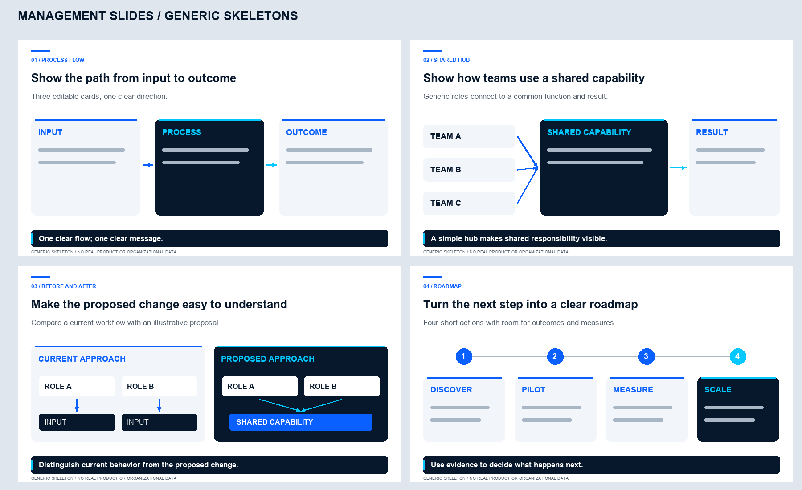

# Management Slides

A portable Agent Skill for clear executive presentations: **3–4 slides**, one message per slide, Arial, white/navy/blue/cyan panels and editable diagrams.



## What's included

| Resource | Purpose |
| --- | --- |
| `SKILL.md` | Agent instructions, visual defaults, evidence rules and revision workflow |
| `references/design-guide.md` | Fonts, colors, geometry, diagram patterns (incl. `system`), diagram build workflow and quality checklist |
| `references/example-deck.json` | Six generic layout skeletons; replace placeholders with vetted content |
| `assets/style-preview.png` | Newly drawn visual reference with no source screenshots or real product data |
| `scripts/build_deck.py` | Optional editable PowerPoint generator; cards move as ungroupable native groups |
| `scripts/build_preview.py` | Recreates the generic skeleton PNG from code |
| `scripts/test_layouts.py` | Structural checks for layouts, live text, fonts, notes, arrowheads and overwrite refusal |
| `requirements.txt` | Optional deck-generation dependency |
| `requirements-preview.txt` | Optional PNG-generation dependency |

## Scripts

| Script | Purpose |
|---|---|
| `scripts/deck_kit.py` | **Design kit.** Type scale, grid, real Arial text measurement, and fit-checked primitives (`card`, `table`, `node`, `badge`, `pill`, `link`, `base`, `row_x`, `center_y`, `card_height`). Raises one error listing every overflow via `finish()`. Build new decks on this. |
| `scripts/lint_deck.py` | Lints any finished `.pptx`: text below 12 pt, text overflowing its shape, non-Arial runs, off-canvas shapes, overlapping text, heavy slides. Exit code 1 on errors. |
| `scripts/render_preview.py` | `.pptx` to PDF, per-slide PNGs and contact sheets, for visual inspection. |
| `scripts/build_deck.py` | Original generator: six simple layouts from a JSON spec. Fixed card heights, no fit check: use only for a short 3–4 slide summary. |
| `references/example-builder.py` | Minimal worked builder on `deck_kit` (cards + table). Copy it. |

Typical flow for a new deck:

```sh
python scripts/lint_deck.py deck.pptx                   # must report 0 errors
python scripts/render_preview.py deck.pptx /tmp/preview  # then look at every slide
```

## Install and use

Copy this complete folder to your host's supported skill directory. For OpenCode, use `~/.agents/skills/management-slides/`; for standalone Claude Code, use `~/.claude/skills/management-slides/`. See [repository installation instructions](../../docs/INSTALL.md) for marketplace use and other hosts. Installation does not execute the scripts.

Example request:

> Use management-slides to create a four-slide executive summary from these documents. Explain the current situation, proposed change, evidence and next steps. Include an editable flow. Save the PowerPoint and PDF to [directory].

## Generate a deck locally

Use Python 3.10 or later in a virtual environment at a suitable scratch location. Run the following from this skill's directory with that environment's Python:

```sh
python -m pip install -r requirements.txt
python scripts/build_deck.py --help
python scripts/build_deck.py --spec references/example-deck.json --output /path/to/output/Skeleton.pptx
python scripts/test_layouts.py   # legacy generator
python scripts/test_kit.py       # design kit and lint
```

Replace the skeleton's labels with researched, concise content before producing a real presentation. Layouts: `cards`, `flow`, `hub`, `before-after`, `roadmap`, `system`. The generator refuses to overwrite by default. Use `--overwrite` only for an authorized file update; it is not a safe replacement for patching an edited deck.

**Boundaries:** the generator does not research facts, export PDF or prove visual quality. It uses native shape groups for cards and live text. In the `system` layout, connectors are glued to the shapes' connection points so they follow a moved node; in the other layouts connectors are separately editable and may need endpoint adjustment. A rough text-fit guard rejects clearly overlong `system` labels, but rendered review is still required. Individual group components can be selected or ungrouped in PowerPoint.

With a locally installed LibreOffice renderer, export a PDF using:

```sh
soffice --headless --convert-to pdf --outdir /path/to/output /path/to/output/Skeleton.pptx
```

Do not upload private decks to an external converter without authorization. Inspect every rendered slide. An existing LibreOffice process may require a separate temporary profile. Font substitution can change wrapping when Arial is unavailable.

## Recreate the generic PNG

The PNG is drawn from scratch; it is **not** a redacted, blurred or cropped private screenshot. It uses only Input / Process / Outcome, Team A–C / Shared capability / Result, Current / Proposed and Discover / Pilot / Measure / Scale.

```sh
python -m pip install -r requirements-preview.txt
python scripts/build_preview.py --output assets/style-preview.png --font /path/to/Arial.ttf --bold-font /path/to/Arial-Bold.ttf
```

Font files are not bundled. Supply locally licensed font files. The preview script is separate from the PowerPoint renderer: its PNG demonstrates the visual language, not a pixel-exact render of a generated deck. It refuses to overwrite unless `--overwrite` is supplied.

## Changelog

- **Design kit, lint and preview** (added after a long deck was judged visually poor): one type scale and grid, measured text fit, flat shapes, visible tags on dark panels, measured table headers, lint and render tooling.
- **Bug fix in `build_deck.py`**: `text()` set font, size, bold and colour on the paragraph (`a:defRPr`), which PowerPoint ignores, so headlines, subtitles, takeaways and footers rendered in the theme font and size in PowerPoint while previews rendered in LibreOffice looked correct. It now sets them on the run. Positions and sizes are unchanged. Decks built before this fix should be rebuilt. The legacy generator otherwise still produces the older look (system diagrams at 12–13 pt); migrate a deck by rebuilding its builder on `deck_kit`.

## Share

Share this whole directory, retaining all supporting resources. No private presentations, real product architectures, original screenshots, credentials or personal paths are required. The MIT license is at the repository root; include it when redistributing a standalone skill bundle.
